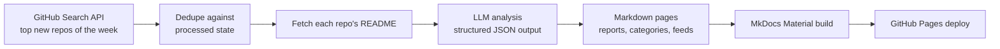

# 📡 Open Source Radar AI

**AI-curated radar of GitHub's hottest new repositories — analyzed, categorized, and published automatically every week.**

[](https://github.com/LokeshNanda/oss-radar-ai/actions/workflows/trending.yml)
[](LICENSE)
[](https://lokeshnanda.github.io/oss-radar-ai/)

👉 **Read this week's radar: [lokeshnanda.github.io/oss-radar-ai](https://lokeshnanda.github.io/oss-radar-ai/)**
📶 Subscribe: [RSS feed](https://lokeshnanda.github.io/oss-radar-ai/feed.xml) · Build on it: [JSON API](https://lokeshnanda.github.io/oss-radar-ai/api/latest.json)

Every Monday, this project finds the most-starred repositories created on GitHub in the last 7 days, generates an honest developer-focused breakdown of each one with an LLM (what it does, why it's interesting, how it works, how to try it, what to watch out for), and publishes everything as a static site — with zero manual steps.

---

## 📡 This week's radar

<!-- RADAR:START -->
_Week of 2026-10-12_

- [`openai/math`](https://github.com/openai/math) ([analysis](https://lokeshnanda.github.io/oss-radar-ai/repos/openai--math/))
- [`storytold/wordcraft`](https://github.com/storytold/wordcraft) — An open-source, clean-room reimplementation of Microsoft Word in pure Rust ([analysis](https://lokeshnanda.github.io/oss-radar-ai/repos/storytold--wordcraft/))
- [`wheresryan22/anatomy`](https://github.com/wheresryan22/anatomy) — An agent skill for creating detailed, interactive isometric illustrations of real-world machines and complex systems. Generates polished SVGs with optional WebGL shaders and 3D effects. ([analysis](https://lokeshnanda.github.io/oss-radar-ai/repos/wheresryan22--anatomy/))
- [`alchaincyf/huashu-art-motion`](https://github.com/alchaincyf/huashu-art-motion) — 艺术动画skill：35种艺术风格、9种解说语法，用代码让画动起来。 ([analysis](https://lokeshnanda.github.io/oss-radar-ai/repos/alchaincyf--huashu-art-motion/))
- [`mhtsec/ARTEX`](https://github.com/mhtsec/ARTEX) — AI 自主渗透测试系统 | 百度“agent+”攻防挑战赛冠军项目 ([analysis](https://lokeshnanda.github.io/oss-radar-ai/repos/mhtsec--artex/))
- [`storytold/gridcraft`](https://github.com/storytold/gridcraft) — GridCraft: an open-source, clean-room spreadsheet (Microsoft Excel-style) in pure Rust. By ArtCraft. ([analysis](https://lokeshnanda.github.io/oss-radar-ai/repos/storytold--gridcraft/))
- [`zhongerxin/iPhone-use`](https://github.com/zhongerxin/iPhone-use) — 让 Codex 通过 USB 操作真实 iPhone：引导安装、App 自动化、实时屏幕与截图回退。 ([analysis](https://lokeshnanda.github.io/oss-radar-ai/repos/zhongerxin--iphone-use/))
- [`storytold/cadcraft`](https://github.com/storytold/cadcraft) — CADCraft: computer-aided design and drafting — an open-source, clean-room AutoCAD-style app in pure Rust ([analysis](https://lokeshnanda.github.io/oss-radar-ai/repos/storytold--cadcraft/))
- [`LosaLosSantos/aurelio-finance`](https://github.com/LosaLosSantos/aurelio-finance) — Open-source personal finance app with an AI financial advisor: track your net worth, investments, ETFs, cash and debts on your own computer. ([analysis](https://lokeshnanda.github.io/oss-radar-ai/repos/losalossantos--aurelio-finance/))
- [`nullmoth/nvidia-macos-driver`](https://github.com/nullmoth/nvidia-macos-driver) — Metal driver for NVIDIA GeForce RTX cards on macOS 15 Sequoia (Intel / OpenCore). Free, source included. ([analysis](https://lokeshnanda.github.io/oss-radar-ai/repos/nullmoth--nvidia-macos-driver/))
<!-- RADAR:END -->

---

## ⚙️ How it works



Everything runs in a single scheduled GitHub Actions workflow. Generated pages and state are committed back to the repo, so every run is reproducible and diffable.

## ✨ Features

- **Weekly radar reports** — the top 10 new repositories, ranked by stars
- **Developer-focused AI analysis** — grounded in each repo's README, honest about uncertainty, no hype
- **Deterministic & idempotent** — same inputs produce byte-identical output; repos are never analyzed twice
- **Fully automated** — fetch → analyze → publish with no human in the loop
- **Cheap to run** — roughly $0.05/week with `gpt-4o-mini`

## 🍴 Run your own radar

This project is designed to be forked. Point it at your favorite niche — a **Rust radar**, an **AI-agents radar**, a **security radar** — by changing a couple of environment variables, adding an API key, and enabling GitHub Pages. Follow the [10-minute setup guide](https://lokeshnanda.github.io/oss-radar-ai/run-your-own/).

## 🚀 Local development

```bash
python -m venv .venv
source .venv/bin/activate   # Windows: .venv\Scripts\activate
pip install -e ".[dev]"

# run the test suite
python -m pytest tests -q

# run the pipeline (needs OPENAI_API_KEY, optional GITHUB_TOKEN)
cp .env.example .env        # then fill in your keys
radar-run

# preview the site
mkdocs serve
```

### Configuration

| Variable                  | Default                  | Purpose                                                                   |
| ------------------------- | ------------------------ | ------------------------------------------------------------------------- |
| `OPENAI_API_KEY`          | —                        | Required. LLM API key                                                     |
| `OPENAI_MODEL`            | `gpt-4o-mini`            | Model used for analysis                                                   |
| `OPENAI_BASE_URL`         | `https://api.openai.com` | Any OpenAI-compatible endpoint                                            |
| `GITHUB_TOKEN`            | —                        | Optional. Raises GitHub API rate limits                                   |
| `GITHUB_PER_PAGE`         | `10`                     | Repos fetched per run                                                     |
| `GITHUB_DAYS_BACK`        | `7`                      | Lookback window in days                                                   |
| `RADAR_MAX_REPOS_PER_RUN` | `10`                     | Cap on repos analyzed per run                                             |
| `RADAR_BLOCKLIST_TERMS`   | —                        | Extra comma-separated terms added to the built-in cheat/malware blocklist |
| `RADAR_BLOCKED_REPOS`     | —                        | Comma-separated `owner/name` repos to never feature                       |

## 🗺 Roadmap

See [ROADMAP.md](ROADMAP.md) and the [design spec](specs/2026-07-24-popularity-roadmap-design.md).

## 📄 License

[MIT](LICENSE)
