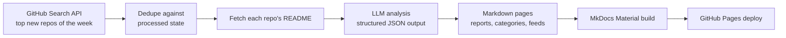

# 📡 Open Source Radar AI

**AI-curated radar of GitHub's hottest new repositories — analyzed, categorized, and published automatically every week.**

[](https://github.com/LokeshNanda/oss-radar-ai/actions/workflows/trending.yml)
[](LICENSE)
[](https://lokeshnanda.github.io/oss-radar-ai/)

👉 **Read this week's radar: [lokeshnanda.github.io/oss-radar-ai](https://lokeshnanda.github.io/oss-radar-ai/)**
📶 Subscribe: [RSS feed](https://lokeshnanda.github.io/oss-radar-ai/feed.xml) · Build on it: [JSON API](https://lokeshnanda.github.io/oss-radar-ai/api/latest.json)

Every Monday, this project finds the most-starred repositories created on GitHub in the last 7 days, generates an honest developer-focused breakdown of each one with an LLM (what it does, why it's interesting, how it works, how to try it, what to watch out for), and publishes everything as a static site — with zero manual steps.

---

## 📡 This week's radar

<!-- RADAR:START -->
_Week of 2026-10-19_

- [`jhaizhou-ops/d2r-mobile`](https://github.com/jhaizhou-ops/d2r-mobile) — Open-source iOS / macOS compatibility layer for Diablo II: Resurrected with the Reign of the Warlock expansion. Runs your own Switch copy natively on iPhone, iPad and Mac — full touch controls, 60 fps, new endgame modes. Bring your own game files. 开源的《暗黑破坏神 II：狱火重生》术士君临 iOS / macOS 兼容层 ([analysis](https://lokeshnanda.github.io/oss-radar-ai/repos/jhaizhou-ops--d2r-mobile/))
- [`Arekejoker/qwen21-nsfw-pose-skill`](https://github.com/Arekejoker/qwen21-nsfw-pose-skill) — Qwen-Image 2.1 NSFW/姿势出图 skill：作者级提示词配方 + NSFW LoRA + 136 姿势 VNCCS 人偶控制；适用 Claude Code / Codex / Cursor / OpenClaw ([analysis](https://lokeshnanda.github.io/oss-radar-ai/repos/arekejoker--qwen21-nsfw-pose-skill/))
- [`Gathin23/cleanyourtv`](https://github.com/Gathin23/cleanyourtv) — Clean Your TV. Debloat any Android TV or Google TV over Wi-Fi and swap the ad-filled home screen for a clean Apple TV-style launcher. No root, fully reversible. cleanyour.tv ([analysis](https://lokeshnanda.github.io/oss-radar-ai/repos/gathin23--cleanyourtv/))
- [`feder-cr/git-ai`](https://github.com/feder-cr/git-ai) — Git designed for AI agents. ([analysis](https://lokeshnanda.github.io/oss-radar-ai/repos/feder-cr--git-ai/))
- [`deeplethe/solid-glass`](https://github.com/deeplethe/solid-glass) — A design system for AI applications. Material, physical, tactile, technical. ([analysis](https://lokeshnanda.github.io/oss-radar-ai/repos/deeplethe--solid-glass/))
- [`HeyPuter/everything`](https://github.com/HeyPuter/everything) — We're rebuilding and open-sourcing the world’s software from scratch. ([analysis](https://lokeshnanda.github.io/oss-radar-ai/repos/heyputer--everything/))
- [`ahwootech/BRUTAL`](https://github.com/ahwootech/BRUTAL) — A free, open source C# framework for making games, or your own game engine. Direct access to native APIs and Vulkan, with the low-level libraries around them. The foundation under Kitten Space Agency and RimWorld's Waylith engine. ([analysis](https://lokeshnanda.github.io/oss-radar-ai/repos/ahwootech--brutal/))
- [`chenglou/handwired`](https://github.com/chenglou/handwired) — Turn your regular JavaScript code into a neural net. ([analysis](https://lokeshnanda.github.io/oss-radar-ai/repos/chenglou--handwired/))
- [`Supermedo/uncharted_pc`](https://github.com/Supermedo/uncharted_pc) — Uncharted: The Nathan Drake Collection running natively on Windows - by SuperMedo ([analysis](https://lokeshnanda.github.io/oss-radar-ai/repos/supermedo--uncharted-pc/))
- [`ly05010419/MacNativeGames`](https://github.com/ly05010419/MacNativeGames) ([analysis](https://lokeshnanda.github.io/oss-radar-ai/repos/ly05010419--macnativegames/))
<!-- RADAR:END -->

---

## ⚙️ How it works



Everything runs in a single scheduled GitHub Actions workflow. Generated pages and state are committed back to the repo, so every run is reproducible and diffable.

## ✨ Features

- **Weekly radar reports** — the top 10 new repositories, ranked by stars
- **Developer-focused AI analysis** — grounded in each repo's README, honest about uncertainty, no hype
- **Deterministic & idempotent** — same inputs produce byte-identical output; repos are never analyzed twice
- **Fully automated** — fetch → analyze → publish with no human in the loop
- **Cheap to run** — roughly $0.05/week with `gpt-4o-mini`

## 🍴 Run your own radar

This project is designed to be forked. Point it at your favorite niche — a **Rust radar**, an **AI-agents radar**, a **security radar** — by changing a couple of environment variables, adding an API key, and enabling GitHub Pages. Follow the [10-minute setup guide](https://lokeshnanda.github.io/oss-radar-ai/run-your-own/).

## 🚀 Local development

```bash
python -m venv .venv
source .venv/bin/activate   # Windows: .venv\Scripts\activate
pip install -e ".[dev]"

# run the test suite
python -m pytest tests -q

# run the pipeline (needs OPENAI_API_KEY, optional GITHUB_TOKEN)
cp .env.example .env        # then fill in your keys
radar-run

# preview the site
mkdocs serve
```

### Configuration

| Variable                  | Default                  | Purpose                                                                   |
| ------------------------- | ------------------------ | ------------------------------------------------------------------------- |
| `OPENAI_API_KEY`          | —                        | Required. LLM API key                                                     |
| `OPENAI_MODEL`            | `gpt-4o-mini`            | Model used for analysis                                                   |
| `OPENAI_BASE_URL`         | `https://api.openai.com` | Any OpenAI-compatible endpoint                                            |
| `GITHUB_TOKEN`            | —                        | Optional. Raises GitHub API rate limits                                   |
| `GITHUB_PER_PAGE`         | `10`                     | Repos fetched per run                                                     |
| `GITHUB_DAYS_BACK`        | `7`                      | Lookback window in days                                                   |
| `RADAR_MAX_REPOS_PER_RUN` | `10`                     | Cap on repos analyzed per run                                             |
| `RADAR_BLOCKLIST_TERMS`   | —                        | Extra comma-separated terms added to the built-in cheat/malware blocklist |
| `RADAR_BLOCKED_REPOS`     | —                        | Comma-separated `owner/name` repos to never feature                       |

## 🗺 Roadmap

See [ROADMAP.md](ROADMAP.md) and the [design spec](specs/2026-07-24-popularity-roadmap-design.md).

## 📄 License

[MIT](LICENSE)
