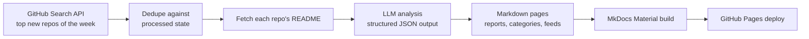

# 📡 Open Source Radar AI

**AI-curated radar of GitHub's hottest new repositories — analyzed, categorized, and published automatically every week.**

[](https://github.com/LokeshNanda/oss-radar-ai/actions/workflows/trending.yml)
[](LICENSE)
[](https://lokeshnanda.github.io/oss-radar-ai/)

👉 **Read this week's radar: [lokeshnanda.github.io/oss-radar-ai](https://lokeshnanda.github.io/oss-radar-ai/)**
📶 Subscribe: [RSS feed](https://lokeshnanda.github.io/oss-radar-ai/feed.xml) · Build on it: [JSON API](https://lokeshnanda.github.io/oss-radar-ai/api/latest.json)

Every Monday, this project finds the most-starred repositories created on GitHub in the last 7 days, generates an honest developer-focused breakdown of each one with an LLM (what it does, why it's interesting, how it works, how to try it, what to watch out for), and publishes everything as a static site — with zero manual steps.

---

## 📡 This week's radar

<!-- RADAR:START -->
_Week of 2026-09-07_

- [`lnkiai/m3e-canvas`](https://github.com/lnkiai/m3e-canvas) — Sketch Material 3 Expressive screens in the browser and turn them into vibe-coding prompts. ([analysis](https://lokeshnanda.github.io/oss-radar-ai/repos/lnkiai--m3e-canvas/))
- [`anthropics/commerce-agents`](https://github.com/anthropics/commerce-agents) — Reference blueprint for building shopping and merchant agents with Claude. Examples in retail, commerce, telecom, and entertainment included. ([analysis](https://lokeshnanda.github.io/oss-radar-ai/repos/anthropics--commerce-agents/))
- [`ashemag/human-atlas`](https://github.com/ashemag/human-atlas) — Open-source 3D anatomy explorer: 2,234 selectable BodyParts3D meshes, system layers, search, and exploded views. ([analysis](https://lokeshnanda.github.io/oss-radar-ai/repos/ashemag--human-atlas/))
- [`Rion-Wu-tech/wechat-intelligence-hub`](https://github.com/Rion-Wu-tech/wechat-intelligence-hub) — Local-first WeChat intelligence system with a read-only CLI, Codex skills, searchable chat history, daily briefings, follow-ups and opportunity tracking. ([analysis](https://lokeshnanda.github.io/oss-radar-ai/repos/rion-wu-tech--wechat-intelligence-hub/))
- [`shadcn-ui/cn`](https://github.com/shadcn-ui/cn) — cn is a new engine for Tailwind class merging and conflict resolution. It replaces tailwind-merge and clsx. Same APIs. Full parity. And it is 30× faster. ([analysis](https://lokeshnanda.github.io/oss-radar-ai/repos/shadcn-ui--cn/))
- [`GangTailorUpgrade/undress-service`](https://github.com/GangTailorUpgrade/undress-service) — Dress AI Sponsor ([analysis](https://lokeshnanda.github.io/oss-radar-ai/repos/gangtailorupgrade--undress-service/))
- [`pierrenade/short-video-generator-AI`](https://github.com/pierrenade/short-video-generator-AI) — Free open-source project designed for turning youtube-viedos into viral short videos. Highlight detection, subtitles, translation, voiceover, all in one for your content. ([analysis](https://lokeshnanda.github.io/oss-radar-ai/repos/pierrenade--short-video-generator-ai/))
- [`sebbbi/NoGraphicsAPI`](https://github.com/sebbbi/NoGraphicsAPI) — Minimal graphics API. Built on top of latest Vulkan extensions. As close as possibly to my "No Graphics API" blog post and the SIGGRAPH talk. ([analysis](https://lokeshnanda.github.io/oss-radar-ai/repos/sebbbi--nographicsapi/))
- [`2akouwu/reverify`](https://github.com/2akouwu/reverify) — Stop your AI from making things up — it proposes, deterministic tools decide, every claim checked against ground truth with evidence. Grounded facts and context survive resets. Reverse engineering is the proving ground. MCP server + CLI. ([analysis](https://lokeshnanda.github.io/oss-radar-ai/repos/2akouwu--reverify/))
- [`anthropics/fermats-last-theorem`](https://github.com/anthropics/fermats-last-theorem) ([analysis](https://lokeshnanda.github.io/oss-radar-ai/repos/anthropics--fermats-last-theorem/))
<!-- RADAR:END -->

---

## ⚙️ How it works



Everything runs in a single scheduled GitHub Actions workflow. Generated pages and state are committed back to the repo, so every run is reproducible and diffable.

## ✨ Features

- **Weekly radar reports** — the top 10 new repositories, ranked by stars
- **Developer-focused AI analysis** — grounded in each repo's README, honest about uncertainty, no hype
- **Deterministic & idempotent** — same inputs produce byte-identical output; repos are never analyzed twice
- **Fully automated** — fetch → analyze → publish with no human in the loop
- **Cheap to run** — roughly $0.05/week with `gpt-4o-mini`

## 🍴 Run your own radar

This project is designed to be forked. Point it at your favorite niche — a **Rust radar**, an **AI-agents radar**, a **security radar** — by changing a couple of environment variables, adding an API key, and enabling GitHub Pages. Follow the [10-minute setup guide](https://lokeshnanda.github.io/oss-radar-ai/run-your-own/).

## 🚀 Local development

```bash
python -m venv .venv
source .venv/bin/activate   # Windows: .venv\Scripts\activate
pip install -e ".[dev]"

# run the test suite
python -m pytest tests -q

# run the pipeline (needs OPENAI_API_KEY, optional GITHUB_TOKEN)
cp .env.example .env        # then fill in your keys
radar-run

# preview the site
mkdocs serve
```

### Configuration

| Variable                  | Default                  | Purpose                                                                   |
| ------------------------- | ------------------------ | ------------------------------------------------------------------------- |
| `OPENAI_API_KEY`          | —                        | Required. LLM API key                                                     |
| `OPENAI_MODEL`            | `gpt-4o-mini`            | Model used for analysis                                                   |
| `OPENAI_BASE_URL`         | `https://api.openai.com` | Any OpenAI-compatible endpoint                                            |
| `GITHUB_TOKEN`            | —                        | Optional. Raises GitHub API rate limits                                   |
| `GITHUB_PER_PAGE`         | `10`                     | Repos fetched per run                                                     |
| `GITHUB_DAYS_BACK`        | `7`                      | Lookback window in days                                                   |
| `RADAR_MAX_REPOS_PER_RUN` | `10`                     | Cap on repos analyzed per run                                             |
| `RADAR_BLOCKLIST_TERMS`   | —                        | Extra comma-separated terms added to the built-in cheat/malware blocklist |
| `RADAR_BLOCKED_REPOS`     | —                        | Comma-separated `owner/name` repos to never feature                       |

## 🗺 Roadmap

See [ROADMAP.md](ROADMAP.md) and the [design spec](specs/2026-07-24-popularity-roadmap-design.md).

## 📄 License

[MIT](LICENSE)
