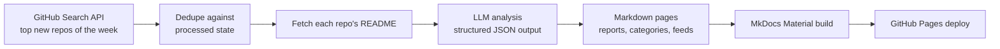

# 📡 Open Source Radar AI

**AI-curated radar of GitHub's hottest new repositories — analyzed, categorized, and published automatically every week.**

[](https://github.com/LokeshNanda/oss-radar-ai/actions/workflows/trending.yml)
[](LICENSE)
[](https://lokeshnanda.github.io/oss-radar-ai/)

👉 **Read this week's radar: [lokeshnanda.github.io/oss-radar-ai](https://lokeshnanda.github.io/oss-radar-ai/)**
📶 Subscribe: [RSS feed](https://lokeshnanda.github.io/oss-radar-ai/feed.xml) · Build on it: [JSON API](https://lokeshnanda.github.io/oss-radar-ai/api/latest.json)

Every Monday, this project finds the most-starred repositories created on GitHub in the last 7 days, generates an honest developer-focused breakdown of each one with an LLM (what it does, why it's interesting, how it works, how to try it, what to watch out for), and publishes everything as a static site — with zero manual steps.

---

## 📡 This week's radar

<!-- RADAR:START -->
_Week of 2026-09-14_

- [`sdli1995/dlssg_for_sm86`](https://github.com/sdli1995/dlssg_for_sm86) — Here is a dlssg for RTX30 Series GPU ([analysis](https://lokeshnanda.github.io/oss-radar-ai/repos/sdli1995--dlssg-for-sm86/))
- [`openai/NavierStokesAndEuler`](https://github.com/openai/NavierStokesAndEuler) — Lean certificates accompanying Navier-Stokes and Euler results ([analysis](https://lokeshnanda.github.io/oss-radar-ai/repos/openai--navierstokesandeuler/))
- [`Edge0-AI/Edge0`](https://github.com/Edge0-AI/Edge0) ([analysis](https://lokeshnanda.github.io/oss-radar-ai/repos/edge0-ai--edge0/))
- [`EverettFish/holo-card-studio`](https://github.com/EverettFish/holo-card-studio) — Turn the user's description or uploaded reference into a finished, editable Blender card and an interactive Three.js page. Preserve the requested subject, style, typography and destination. This skill contains code and text only; generated artwork belongs in the user's output project. ([analysis](https://lokeshnanda.github.io/oss-radar-ai/repos/everettfish--holo-card-studio/))
- [`Vincentwei1021/anything2explainer`](https://github.com/Vincentwei1021/anything2explainer) — Topic in, narrated explainer video out. A Claude Code / Codex skill that turns any topic into a black-canvas motion-graphics explainer video with TTS voiceover, subtitles and a chapter progress bar. Chinese or English; every frame drawn in code with Remotion. ([analysis](https://lokeshnanda.github.io/oss-radar-ai/repos/vincentwei1021--anything2explainer/))
- [`achimala/dream-loop`](https://github.com/achimala/dream-loop) — Agent skill for impressive 3D visuals using Blender + image gen + subagent critic ([analysis](https://lokeshnanda.github.io/oss-radar-ai/repos/achimala--dream-loop/))
- [`crwdla/tokentab`](https://github.com/crwdla/tokentab) — A CLI that reads Claude Code, Codex, and Gemini CLI session logs and works out how much they cost, by model, project, and day. ([analysis](https://lokeshnanda.github.io/oss-radar-ai/repos/crwdla--tokentab/))
- [`gazijarin/itsgiving`](https://github.com/gazijarin/itsgiving) — Express yourself in meetings (with memes, of course). ([analysis](https://lokeshnanda.github.io/oss-radar-ai/repos/gazijarin--itsgiving/))
- [`sumimakito/Mac-Duo`](https://github.com/sumimakito/Mac-Duo) — Wish you could bring the iPhone Duo effect to your MacBook? ([analysis](https://lokeshnanda.github.io/oss-radar-ai/repos/sumimakito--mac-duo/))
- [`SpaceDudem/text-humanizer`](https://github.com/SpaceDudem/text-humanizer) — text-humanizer is an open-source project designed to convert text generated by AI to its "humanized" version. Bypasses the most of AI detectors such as Turnitin or GPTZero ([analysis](https://lokeshnanda.github.io/oss-radar-ai/repos/spacedudem--text-humanizer/))
<!-- RADAR:END -->

---

## ⚙️ How it works



Everything runs in a single scheduled GitHub Actions workflow. Generated pages and state are committed back to the repo, so every run is reproducible and diffable.

## ✨ Features

- **Weekly radar reports** — the top 10 new repositories, ranked by stars
- **Developer-focused AI analysis** — grounded in each repo's README, honest about uncertainty, no hype
- **Deterministic & idempotent** — same inputs produce byte-identical output; repos are never analyzed twice
- **Fully automated** — fetch → analyze → publish with no human in the loop
- **Cheap to run** — roughly $0.05/week with `gpt-4o-mini`

## 🍴 Run your own radar

This project is designed to be forked. Point it at your favorite niche — a **Rust radar**, an **AI-agents radar**, a **security radar** — by changing a couple of environment variables, adding an API key, and enabling GitHub Pages. Follow the [10-minute setup guide](https://lokeshnanda.github.io/oss-radar-ai/run-your-own/).

## 🚀 Local development

```bash
python -m venv .venv
source .venv/bin/activate   # Windows: .venv\Scripts\activate
pip install -e ".[dev]"

# run the test suite
python -m pytest tests -q

# run the pipeline (needs OPENAI_API_KEY, optional GITHUB_TOKEN)
cp .env.example .env        # then fill in your keys
radar-run

# preview the site
mkdocs serve
```

### Configuration

| Variable                  | Default                  | Purpose                                                                   |
| ------------------------- | ------------------------ | ------------------------------------------------------------------------- |
| `OPENAI_API_KEY`          | —                        | Required. LLM API key                                                     |
| `OPENAI_MODEL`            | `gpt-4o-mini`            | Model used for analysis                                                   |
| `OPENAI_BASE_URL`         | `https://api.openai.com` | Any OpenAI-compatible endpoint                                            |
| `GITHUB_TOKEN`            | —                        | Optional. Raises GitHub API rate limits                                   |
| `GITHUB_PER_PAGE`         | `10`                     | Repos fetched per run                                                     |
| `GITHUB_DAYS_BACK`        | `7`                      | Lookback window in days                                                   |
| `RADAR_MAX_REPOS_PER_RUN` | `10`                     | Cap on repos analyzed per run                                             |
| `RADAR_BLOCKLIST_TERMS`   | —                        | Extra comma-separated terms added to the built-in cheat/malware blocklist |
| `RADAR_BLOCKED_REPOS`     | —                        | Comma-separated `owner/name` repos to never feature                       |

## 🗺 Roadmap

See [ROADMAP.md](ROADMAP.md) and the [design spec](specs/2026-07-24-popularity-roadmap-design.md).

## 📄 License

[MIT](LICENSE)
