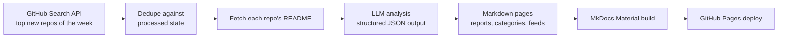

# 📡 Open Source Radar AI

**AI-curated radar of GitHub's hottest new repositories — analyzed, categorized, and published automatically every week.**

[](https://github.com/LokeshNanda/oss-radar-ai/actions/workflows/trending.yml)
[](LICENSE)
[](https://lokeshnanda.github.io/oss-radar-ai/)

👉 **Read this week's radar: [lokeshnanda.github.io/oss-radar-ai](https://lokeshnanda.github.io/oss-radar-ai/)**
📶 Subscribe: [RSS feed](https://lokeshnanda.github.io/oss-radar-ai/feed.xml) · Build on it: [JSON API](https://lokeshnanda.github.io/oss-radar-ai/api/latest.json)

Every Monday, this project finds the most-starred repositories created on GitHub in the last 7 days, generates an honest developer-focused breakdown of each one with an LLM (what it does, why it's interesting, how it works, how to try it, what to watch out for), and publishes everything as a static site — with zero manual steps.

---

## 📡 This week's radar

<!-- RADAR:START -->
_Week of 2026-11-02_

- [`deepseek-ai/dsh-superagent-prototype`](https://github.com/deepseek-ai/dsh-superagent-prototype) — Towards a More Autonomous Agent System ([analysis](https://lokeshnanda.github.io/oss-radar-ai/repos/deepseek-ai--dsh-superagent-prototype/))
- [`heydamir/unslop`](https://github.com/heydamir/unslop) — A Claude skill that turns vibecoded, AI-looking UI into a designed interface ([analysis](https://lokeshnanda.github.io/oss-radar-ai/repos/heydamir--unslop/))
- [`anhao/ai-pose-gallery-zh`](https://github.com/anhao/ai-pose-gallery-zh) — 中文版 AI 姿势参考图库 · 1439 组 / 2878 张图片 / 完整汉化 · 零依赖静态画廊 ([analysis](https://lokeshnanda.github.io/oss-radar-ai/repos/anhao--ai-pose-gallery-zh/))
- [`wangzan101/Mika`](https://github.com/wangzan101/Mika) — An on-device AI agent for Android that operates apps and the web to get things done for you. ([analysis](https://lokeshnanda.github.io/oss-radar-ai/repos/wangzan101--mika/))
- [`valentderah/totk-pc-recomp`](https://github.com/valentderah/totk-pc-recomp) — Static recompilation of The Legend of Zelda: Tears of the Kingdom to native Windows x86-64, with a Vulkan renderer. Game files not included. ([analysis](https://lokeshnanda.github.io/oss-radar-ai/repos/valentderah--totk-pc-recomp/))
- [`patch-gg/pixelfx`](https://github.com/patch-gg/pixelfx) — 244 pixel art effects, every one a small piece of code. Plus a Claude Code skill to make your own. ([analysis](https://lokeshnanda.github.io/oss-radar-ai/repos/patch-gg--pixelfx/))
- [`storytold/craft-anything`](https://github.com/storytold/craft-anything) — Craft Anything: understand how any software works, and craft your own. ([analysis](https://lokeshnanda.github.io/oss-radar-ai/repos/storytold--craft-anything/))
- [`Djihads80/Eglantine`](https://github.com/Djihads80/Eglantine) — VERY experimental Nintendo Switch 2 emulator ([analysis](https://lokeshnanda.github.io/oss-radar-ai/repos/djihads80--eglantine/))
- [`haydenschmitty/floorplan`](https://github.com/haydenschmitty/floorplan) — See how your app actually fits together. An interactive, plain-English map of your codebase, drawn by Claude or Codex. ([analysis](https://lokeshnanda.github.io/oss-radar-ai/repos/haydenschmitty--floorplan/))
- [`paipiange/nvzhuang`](https://github.com/paipiange/nvzhuang) — 1407 张 AI 女装参考图集与虚拟试穿网站，支持中英检索、OpenAI Images / Gemini / 豆包及自定义 Base URL、API Key、模型。https://github.com/paipiange/nvzhuang ([analysis](https://lokeshnanda.github.io/oss-radar-ai/repos/paipiange--nvzhuang/))
<!-- RADAR:END -->

---

## ⚙️ How it works



Everything runs in a single scheduled GitHub Actions workflow. Generated pages and state are committed back to the repo, so every run is reproducible and diffable.

## ✨ Features

- **Weekly radar reports** — the top 10 new repositories, ranked by stars
- **Developer-focused AI analysis** — grounded in each repo's README, honest about uncertainty, no hype
- **Deterministic & idempotent** — same inputs produce byte-identical output; repos are never analyzed twice
- **Fully automated** — fetch → analyze → publish with no human in the loop
- **Cheap to run** — roughly $0.05/week with `gpt-4o-mini`

## 🍴 Run your own radar

This project is designed to be forked. Point it at your favorite niche — a **Rust radar**, an **AI-agents radar**, a **security radar** — by changing a couple of environment variables, adding an API key, and enabling GitHub Pages. Follow the [10-minute setup guide](https://lokeshnanda.github.io/oss-radar-ai/run-your-own/).

## 🚀 Local development

```bash
python -m venv .venv
source .venv/bin/activate   # Windows: .venv\Scripts\activate
pip install -e ".[dev]"

# run the test suite
python -m pytest tests -q

# run the pipeline (needs OPENAI_API_KEY, optional GITHUB_TOKEN)
cp .env.example .env        # then fill in your keys
radar-run

# preview the site
mkdocs serve
```

### Configuration

| Variable                  | Default                  | Purpose                                                                   |
| ------------------------- | ------------------------ | ------------------------------------------------------------------------- |
| `OPENAI_API_KEY`          | —                        | Required. LLM API key                                                     |
| `OPENAI_MODEL`            | `gpt-4o-mini`            | Model used for analysis                                                   |
| `OPENAI_BASE_URL`         | `https://api.openai.com` | Any OpenAI-compatible endpoint                                            |
| `GITHUB_TOKEN`            | —                        | Optional. Raises GitHub API rate limits                                   |
| `GITHUB_PER_PAGE`         | `10`                     | Repos fetched per run                                                     |
| `GITHUB_DAYS_BACK`        | `7`                      | Lookback window in days                                                   |
| `RADAR_MAX_REPOS_PER_RUN` | `10`                     | Cap on repos analyzed per run                                             |
| `RADAR_BLOCKLIST_TERMS`   | —                        | Extra comma-separated terms added to the built-in cheat/malware blocklist |
| `RADAR_BLOCKED_REPOS`     | —                        | Comma-separated `owner/name` repos to never feature                       |

## 🗺 Roadmap

See [ROADMAP.md](ROADMAP.md) and the [design spec](specs/2026-07-24-popularity-roadmap-design.md).

## 📄 License

[MIT](LICENSE)
