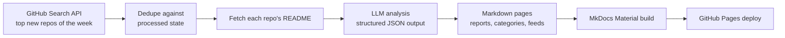

# 📡 Open Source Radar AI

**AI-curated radar of GitHub's hottest new repositories — analyzed, categorized, and published automatically every week.**

[](https://github.com/LokeshNanda/oss-radar-ai/actions/workflows/trending.yml)
[](LICENSE)
[](https://lokeshnanda.github.io/oss-radar-ai/)

👉 **Read this week's radar: [lokeshnanda.github.io/oss-radar-ai](https://lokeshnanda.github.io/oss-radar-ai/)**
📶 Subscribe: [RSS feed](https://lokeshnanda.github.io/oss-radar-ai/feed.xml) · Build on it: [JSON API](https://lokeshnanda.github.io/oss-radar-ai/api/latest.json)

Every Monday, this project finds the most-starred repositories created on GitHub in the last 7 days, generates an honest developer-focused breakdown of each one with an LLM (what it does, why it's interesting, how it works, how to try it, what to watch out for), and publishes everything as a static site — with zero manual steps.

---

## 📡 This week's radar

<!-- RADAR:START -->
_Week of 2026-09-21_

- [`browser-use/jev-ultrafast`](https://github.com/browser-use/jev-ultrafast) — i. am. speed. ([analysis](https://lokeshnanda.github.io/oss-radar-ai/repos/browser-use--jev-ultrafast/))
- [`NandhaKishorM/laya`](https://github.com/NandhaKishorM/laya) ([analysis](https://lokeshnanda.github.io/oss-radar-ai/repos/nandhakishorm--laya/))
- [`tamaratran/fast-jev-compaction`](https://github.com/tamaratran/fast-jev-compaction) — Claude Code plugin that replaces the compaction summary with Jev decisions: every tool call and result is scored in one fast request, stale ones are dropped or truncated, everything kept stays verbatim. ([analysis](https://lokeshnanda.github.io/oss-radar-ai/repos/tamaratran--fast-jev-compaction/))
- [`zai-org/ZCode`](https://github.com/zai-org/ZCode) — Z.ai's coding agent harness. Powerful, intelligent, extensible. ([analysis](https://lokeshnanda.github.io/oss-radar-ai/repos/zai-org--zcode/))
- [`robbietilton/Compositor`](https://github.com/robbietilton/Compositor) — The Photoshop alternative for Mac ([analysis](https://lokeshnanda.github.io/oss-radar-ai/repos/robbietilton--compositor/))
- [`TheoLeeCJ/SemIf`](https://github.com/TheoLeeCJ/SemIf) — Semantic ifs from open models, on a 3090 at home. Independent; not affiliated with Jev or TypeSafe. ([analysis](https://lokeshnanda.github.io/oss-radar-ai/repos/theoleecj--semif/))
- [`mizorewww/laya-mlx`](https://github.com/mizorewww/laya-mlx) — Native MLX runtime for Laya typed decision models — 7–14 ms short decisions on M3 Max. No text generation, PyTorch, or cloud API. ([analysis](https://lokeshnanda.github.io/oss-radar-ai/repos/mizorewww--laya-mlx/))
- [`mcncarl/jianying-headless`](https://github.com/mcncarl/jianying-headless) — Private source preview: native Jianying drafts, isolated editing/export, and standalone Agent Skill. ([analysis](https://lokeshnanda.github.io/oss-radar-ai/repos/mcncarl--jianying-headless/))
- [`jarrodwatts/jev-trader`](https://github.com/jarrodwatts/jev-trader) — One AI trade decision every Monad block. Jev on Kuru MON-USDC. ([analysis](https://lokeshnanda.github.io/oss-radar-ai/repos/jarrodwatts--jev-trader/))
- [`TianyuCodings/NanoJev`](https://github.com/TianyuCodings/NanoJev) — A nano replica of Jev: parallel decisions, dynamic candidates, and an end-to-end training pipeline. ([analysis](https://lokeshnanda.github.io/oss-radar-ai/repos/tianyucodings--nanojev/))
<!-- RADAR:END -->

---

## ⚙️ How it works



Everything runs in a single scheduled GitHub Actions workflow. Generated pages and state are committed back to the repo, so every run is reproducible and diffable.

## ✨ Features

- **Weekly radar reports** — the top 10 new repositories, ranked by stars
- **Developer-focused AI analysis** — grounded in each repo's README, honest about uncertainty, no hype
- **Deterministic & idempotent** — same inputs produce byte-identical output; repos are never analyzed twice
- **Fully automated** — fetch → analyze → publish with no human in the loop
- **Cheap to run** — roughly $0.05/week with `gpt-4o-mini`

## 🍴 Run your own radar

This project is designed to be forked. Point it at your favorite niche — a **Rust radar**, an **AI-agents radar**, a **security radar** — by changing a couple of environment variables, adding an API key, and enabling GitHub Pages. Follow the [10-minute setup guide](https://lokeshnanda.github.io/oss-radar-ai/run-your-own/).

## 🚀 Local development

```bash
python -m venv .venv
source .venv/bin/activate   # Windows: .venv\Scripts\activate
pip install -e ".[dev]"

# run the test suite
python -m pytest tests -q

# run the pipeline (needs OPENAI_API_KEY, optional GITHUB_TOKEN)
cp .env.example .env        # then fill in your keys
radar-run

# preview the site
mkdocs serve
```

### Configuration

| Variable                  | Default                  | Purpose                                                                   |
| ------------------------- | ------------------------ | ------------------------------------------------------------------------- |
| `OPENAI_API_KEY`          | —                        | Required. LLM API key                                                     |
| `OPENAI_MODEL`            | `gpt-4o-mini`            | Model used for analysis                                                   |
| `OPENAI_BASE_URL`         | `https://api.openai.com` | Any OpenAI-compatible endpoint                                            |
| `GITHUB_TOKEN`            | —                        | Optional. Raises GitHub API rate limits                                   |
| `GITHUB_PER_PAGE`         | `10`                     | Repos fetched per run                                                     |
| `GITHUB_DAYS_BACK`        | `7`                      | Lookback window in days                                                   |
| `RADAR_MAX_REPOS_PER_RUN` | `10`                     | Cap on repos analyzed per run                                             |
| `RADAR_BLOCKLIST_TERMS`   | —                        | Extra comma-separated terms added to the built-in cheat/malware blocklist |
| `RADAR_BLOCKED_REPOS`     | —                        | Comma-separated `owner/name` repos to never feature                       |

## 🗺 Roadmap

See [ROADMAP.md](ROADMAP.md) and the [design spec](specs/2026-07-24-popularity-roadmap-design.md).

## 📄 License

[MIT](LICENSE)
