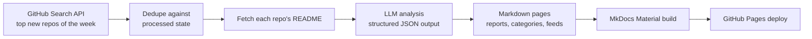

# 📡 Open Source Radar AI

**AI-curated radar of GitHub's hottest new repositories — analyzed, categorized, and published automatically every week.**

[](https://github.com/LokeshNanda/oss-radar-ai/actions/workflows/trending.yml)
[](LICENSE)
[](https://lokeshnanda.github.io/oss-radar-ai/)

👉 **Read this week's radar: [lokeshnanda.github.io/oss-radar-ai](https://lokeshnanda.github.io/oss-radar-ai/)**
📶 Subscribe: [RSS feed](https://lokeshnanda.github.io/oss-radar-ai/feed.xml) · Build on it: [JSON API](https://lokeshnanda.github.io/oss-radar-ai/api/latest.json)

Every Monday, this project finds the most-starred repositories created on GitHub in the last 7 days, generates an honest developer-focused breakdown of each one with an LLM (what it does, why it's interesting, how it works, how to try it, what to watch out for), and publishes everything as a static site — with zero manual steps.

---

## 📡 This week's radar

<!-- RADAR:START -->
_Week of 2026-10-05_

- [`KKKKhazix/AIHOT`](https://github.com/KKKKhazix/AIHOT) — 一个自己找热点、自己写日报的网站框架。把信源和精选标准换成你的，它就是你的行业热点站。 ([analysis](https://lokeshnanda.github.io/oss-radar-ai/repos/kkkkhazix--aihot/))
- [`rehan-remade/universal-modder`](https://github.com/rehan-remade/universal-modder) — Point Claude at any game. Skills, tools and the fal MCP that let Claude Code mod almost any PC game you own: recon, reverse engineering, fal-generated art/3D/audio, in-game testing, showcase videos. ([analysis](https://lokeshnanda.github.io/oss-radar-ai/repos/rehan-remade--universal-modder/))
- [`CopilotKit/OpenDots`](https://github.com/CopilotKit/OpenDots) — Your always-on AI coworkers that move between text, calls, and Slack. ([analysis](https://lokeshnanda.github.io/oss-radar-ai/repos/copilotkit--opendots/))
- [`feder-cr/dots`](https://github.com/feder-cr/dots) — Open-source dots for the web: an AI agent with its own browser, one that does not get blocked. ([analysis](https://lokeshnanda.github.io/oss-radar-ai/repos/feder-cr--dots/))
- [`nanaism/yomiyasu`](https://github.com/nanaism/yomiyasu) — AI生成の日本語を自然な日本語へ推敲するAgent Skill / Agent Skill for Refining AI-Generated Japanese into Natural Japanese ([analysis](https://lokeshnanda.github.io/oss-radar-ai/repos/nanaism--yomiyasu/))
- [`storytold/photocraft`](https://github.com/storytold/photocraft) — An open-source, clean-room reimplementation of Adobe Photoshop in pure Rust ([analysis](https://lokeshnanda.github.io/oss-radar-ai/repos/storytold--photocraft/))
- [`wy51ai/floorplan-3d`](https://github.com/wy51ai/floorplan-3d) ([analysis](https://lokeshnanda.github.io/oss-radar-ai/repos/wy51ai--floorplan-3d/))
- [`firelex/jeff`](https://github.com/firelex/jeff) — Millisecond decisions, any domain: a 0.8B open "System 1" model that picks between your options with calibrated probabilities. One base, swappable LoRA adapters, on your own hardware. ([analysis](https://lokeshnanda.github.io/oss-radar-ai/repos/firelex--jeff/))
- [`facebookincubator/muse-gadget-sdk`](https://github.com/facebookincubator/muse-gadget-sdk) — Open source SDK to build Muse gadgets ([analysis](https://lokeshnanda.github.io/oss-radar-ai/repos/facebookincubator--muse-gadget-sdk/))
- [`QingYunA/answer-me-with-html`](https://github.com/QingYunA/answer-me-with-html) — Answer me with HTML — an agent skill that answers hard questions with a one-page HTML you can actually read. 让 AI Agent 用一页 HTML 回答复杂问题。 ([analysis](https://lokeshnanda.github.io/oss-radar-ai/repos/qingyuna--answer-me-with-html/))
<!-- RADAR:END -->

---

## ⚙️ How it works



Everything runs in a single scheduled GitHub Actions workflow. Generated pages and state are committed back to the repo, so every run is reproducible and diffable.

## ✨ Features

- **Weekly radar reports** — the top 10 new repositories, ranked by stars
- **Developer-focused AI analysis** — grounded in each repo's README, honest about uncertainty, no hype
- **Deterministic & idempotent** — same inputs produce byte-identical output; repos are never analyzed twice
- **Fully automated** — fetch → analyze → publish with no human in the loop
- **Cheap to run** — roughly $0.05/week with `gpt-4o-mini`

## 🍴 Run your own radar

This project is designed to be forked. Point it at your favorite niche — a **Rust radar**, an **AI-agents radar**, a **security radar** — by changing a couple of environment variables, adding an API key, and enabling GitHub Pages. Follow the [10-minute setup guide](https://lokeshnanda.github.io/oss-radar-ai/run-your-own/).

## 🚀 Local development

```bash
python -m venv .venv
source .venv/bin/activate   # Windows: .venv\Scripts\activate
pip install -e ".[dev]"

# run the test suite
python -m pytest tests -q

# run the pipeline (needs OPENAI_API_KEY, optional GITHUB_TOKEN)
cp .env.example .env        # then fill in your keys
radar-run

# preview the site
mkdocs serve
```

### Configuration

| Variable                  | Default                  | Purpose                                                                   |
| ------------------------- | ------------------------ | ------------------------------------------------------------------------- |
| `OPENAI_API_KEY`          | —                        | Required. LLM API key                                                     |
| `OPENAI_MODEL`            | `gpt-4o-mini`            | Model used for analysis                                                   |
| `OPENAI_BASE_URL`         | `https://api.openai.com` | Any OpenAI-compatible endpoint                                            |
| `GITHUB_TOKEN`            | —                        | Optional. Raises GitHub API rate limits                                   |
| `GITHUB_PER_PAGE`         | `10`                     | Repos fetched per run                                                     |
| `GITHUB_DAYS_BACK`        | `7`                      | Lookback window in days                                                   |
| `RADAR_MAX_REPOS_PER_RUN` | `10`                     | Cap on repos analyzed per run                                             |
| `RADAR_BLOCKLIST_TERMS`   | —                        | Extra comma-separated terms added to the built-in cheat/malware blocklist |
| `RADAR_BLOCKED_REPOS`     | —                        | Comma-separated `owner/name` repos to never feature                       |

## 🗺 Roadmap

See [ROADMAP.md](ROADMAP.md) and the [design spec](specs/2026-07-24-popularity-roadmap-design.md).

## 📄 License

[MIT](LICENSE)
