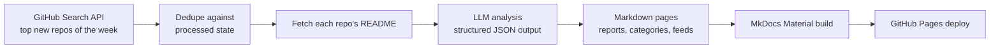

# 📡 Open Source Radar AI

**AI-curated radar of GitHub's hottest new repositories — analyzed, categorized, and published automatically every week.**

[](https://github.com/LokeshNanda/oss-radar-ai/actions/workflows/trending.yml)
[](LICENSE)
[](https://lokeshnanda.github.io/oss-radar-ai/)

👉 **Read this week's radar: [lokeshnanda.github.io/oss-radar-ai](https://lokeshnanda.github.io/oss-radar-ai/)**
📶 Subscribe: [RSS feed](https://lokeshnanda.github.io/oss-radar-ai/feed.xml) · Build on it: [JSON API](https://lokeshnanda.github.io/oss-radar-ai/api/latest.json)

Every Monday, this project finds the most-starred repositories created on GitHub in the last 7 days, generates an honest developer-focused breakdown of each one with an LLM (what it does, why it's interesting, how it works, how to try it, what to watch out for), and publishes everything as a static site — with zero manual steps.

---

## 📡 This week's radar

<!-- RADAR:START -->
_Week of 2026-11-23_

- [`ItsNotRexed/Leonida`](https://github.com/ItsNotRexed/Leonida) — Leonida Is A Native PC Recompilation Of The Xbox Version Of Grand Theft Auto 6 ([analysis](https://lokeshnanda.github.io/oss-radar-ai/repos/itsnotrexed--leonida/))
- [`erkamyaman/rust-anything`](https://github.com/erkamyaman/rust-anything) — Rewrite your whole app in Rust, one piece at a time, checked against the original's recorded behavior at every step. CLIs, HTTP servers and libraries in TypeScript, Python, C, Go, Ruby and Java. ([analysis](https://lokeshnanda.github.io/oss-radar-ai/repos/erkamyaman--rust-anything/))
- [`EL4CTEO/fast-anything`](https://github.com/EL4CTEO/fast-anything) — Don't rewrite it in Rust. Rewrite the 5% that's slow: profile Python, Node or Ruby apps, port the hot functions with your coding agent, prove they behave the same. ([analysis](https://lokeshnanda.github.io/oss-radar-ai/repos/el4cteo--fast-anything/))
- [`bookwjitchieni1986/blender-ai-mcp-addon`](https://github.com/bookwjitchieni1986/blender-ai-mcp-addon) — AI assistant and MCP server for Blender: visual chat, scene tools, multi-agent workflows. Works with ChatGPT/GPT, Claude, Gemini, Ollama, OpenCode. Blender AI addon, copilot for 3D, bpy Python scripting, MCP integration. ([analysis](https://lokeshnanda.github.io/oss-radar-ai/repos/bookwjitchieni1986--blender-ai-mcp-addon/))
- [`iamajmeena/neonclipping`](https://github.com/iamajmeena/neonclipping) — Paste a link, get captioned 9:16 clips in ~2 min. Free, local, open-source clipping engine (audio-first, YouTube captions, local LLM). ([analysis](https://lokeshnanda.github.io/oss-radar-ai/repos/iamajmeena--neonclipping/))
- [`sybil-solutions/inference-optimisation-skill`](https://github.com/sybil-solutions/inference-optimisation-skill) — Agent skill for hill-climbing local LLM serving speed (decode, speculative decoding, prefill, KV, startup, TTFT) on any hardware and quantization ([analysis](https://lokeshnanda.github.io/oss-radar-ai/repos/sybil-solutions--inference-optimisation-skill/))
- [`omonkeyz/xbox-emulator`](https://github.com/omonkeyz/xbox-emulator) — Progress notes for running Xbox Series X|S builds on PC (TomBox + rage9) ([analysis](https://lokeshnanda.github.io/oss-radar-ai/repos/omonkeyz--xbox-emulator/))
- [`R0Y00/Xbox2Windows`](https://github.com/R0Y00/Xbox2Windows) — Static recompilation research for Xbox Series X|S software on x64 Windows, with source-built CPU and GPU tests. Full-game startup is unverified. ([analysis](https://lokeshnanda.github.io/oss-radar-ai/repos/r0y00--xbox2windows/))
- [`Lemxy/WinRust`](https://github.com/Lemxy/WinRust) — Windows shell replacement in Rust: taskbar, file manager, NTFS search, task manager, disk cleaner. One installer exe. ([analysis](https://lokeshnanda.github.io/oss-radar-ai/repos/lemxy--winrust/))
- [`AFK-surf/xnulinux`](https://github.com/AFK-surf/xnulinux) — XNU as a loadable kernel module inside Linux (macOS personality for arm64 Linux) ([analysis](https://lokeshnanda.github.io/oss-radar-ai/repos/afk-surf--xnulinux/))
<!-- RADAR:END -->

---

## ⚙️ How it works



Everything runs in a single scheduled GitHub Actions workflow. Generated pages and state are committed back to the repo, so every run is reproducible and diffable.

## ✨ Features

- **Weekly radar reports** — the top 10 new repositories, ranked by stars
- **Developer-focused AI analysis** — grounded in each repo's README, honest about uncertainty, no hype
- **Deterministic & idempotent** — same inputs produce byte-identical output; repos are never analyzed twice
- **Fully automated** — fetch → analyze → publish with no human in the loop
- **Cheap to run** — roughly $0.05/week with `gpt-4o-mini`

## 🍴 Run your own radar

This project is designed to be forked. Point it at your favorite niche — a **Rust radar**, an **AI-agents radar**, a **security radar** — by changing a couple of environment variables, adding an API key, and enabling GitHub Pages. Follow the [10-minute setup guide](https://lokeshnanda.github.io/oss-radar-ai/run-your-own/).

## 🚀 Local development

```bash
python -m venv .venv
source .venv/bin/activate   # Windows: .venv\Scripts\activate
pip install -e ".[dev]"

# run the test suite
python -m pytest tests -q

# run the pipeline (needs OPENAI_API_KEY, optional GITHUB_TOKEN)
cp .env.example .env        # then fill in your keys
radar-run

# preview the site
mkdocs serve
```

### Configuration

| Variable                  | Default                  | Purpose                                                                   |
| ------------------------- | ------------------------ | ------------------------------------------------------------------------- |
| `OPENAI_API_KEY`          | —                        | Required. LLM API key                                                     |
| `OPENAI_MODEL`            | `gpt-4o-mini`            | Model used for analysis                                                   |
| `OPENAI_BASE_URL`         | `https://api.openai.com` | Any OpenAI-compatible endpoint                                            |
| `GITHUB_TOKEN`            | —                        | Optional. Raises GitHub API rate limits                                   |
| `GITHUB_PER_PAGE`         | `10`                     | Repos fetched per run                                                     |
| `GITHUB_DAYS_BACK`        | `7`                      | Lookback window in days                                                   |
| `RADAR_MAX_REPOS_PER_RUN` | `10`                     | Cap on repos analyzed per run                                             |
| `RADAR_BLOCKLIST_TERMS`   | —                        | Extra comma-separated terms added to the built-in cheat/malware blocklist |
| `RADAR_BLOCKED_REPOS`     | —                        | Comma-separated `owner/name` repos to never feature                       |

## 🗺 Roadmap

See [ROADMAP.md](ROADMAP.md) and the [design spec](specs/2026-07-24-popularity-roadmap-design.md).

## 📄 License

[MIT](LICENSE)
