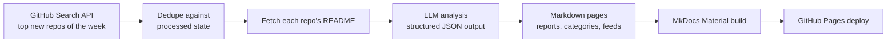

# 📡 Open Source Radar AI

**AI-curated radar of GitHub's hottest new repositories — analyzed, categorized, and published automatically every week.**

[](https://github.com/LokeshNanda/oss-radar-ai/actions/workflows/trending.yml)
[](LICENSE)
[](https://lokeshnanda.github.io/oss-radar-ai/)

👉 **Read this week's radar: [lokeshnanda.github.io/oss-radar-ai](https://lokeshnanda.github.io/oss-radar-ai/)**
📶 Subscribe: [RSS feed](https://lokeshnanda.github.io/oss-radar-ai/feed.xml) · Build on it: [JSON API](https://lokeshnanda.github.io/oss-radar-ai/api/latest.json)

Every Monday, this project finds the most-starred repositories created on GitHub in the last 7 days, generates an honest developer-focused breakdown of each one with an LLM (what it does, why it's interesting, how it works, how to try it, what to watch out for), and publishes everything as a static site — with zero manual steps.

---

## 📡 This week's radar

<!-- RADAR:START -->
_Week of 2026-11-09_

- [`Minireel/HGhub`](https://github.com/Minireel/HGhub) — YellowFruit third-party client ([analysis](https://lokeshnanda.github.io/oss-radar-ai/repos/minireel--hghub/))
- [`KKKKhazix/agent-autoloop`](https://github.com/KKKKhazix/agent-autoloop) — 让你的命令行 Agent 在后台自己接活、自己跟进到底；平时不烦你，遇到拿不准的事才发卡片找你拍板。 ([analysis](https://lokeshnanda.github.io/oss-radar-ai/repos/kkkkhazix--agent-autoloop/))
- [`NotRexed/Hookshot`](https://github.com/NotRexed/Hookshot) — A Native Recompilation Of The Legend Of Zelda: Ocarina Of Time Nintendo Switch 2 Remake ([analysis](https://lokeshnanda.github.io/oss-radar-ai/repos/notrexed--hookshot/))
- [`govijr/terminal-mac`](https://github.com/govijr/terminal-mac) — Entire MacOS running in your terminal. ([analysis](https://lokeshnanda.github.io/oss-radar-ai/repos/govijr--terminal-mac/))
- [`tangerineturtle1/NX2navi`](https://github.com/tangerineturtle1/NX2navi) ([analysis](https://lokeshnanda.github.io/oss-radar-ai/repos/tangerineturtle1--nx2navi/))
- [`JenkinWoo/sheeridVerify`](https://github.com/JenkinWoo/sheeridVerify) ([analysis](https://lokeshnanda.github.io/oss-radar-ai/repos/jenkinwoo--sheeridverify/))
- [`sarpstar/cinecode`](https://github.com/sarpstar/cinecode) — Films made with code. Short films, long YouTube videos, ads, explainers and music videos: an AI coding agent writes the script, builds every frame in code, designs the sound and hands you an MP4. ([analysis](https://lokeshnanda.github.io/oss-radar-ai/repos/sarpstar--cinecode/))
- [`Sandflow-ai/sand3d`](https://github.com/Sandflow-ai/sand3d) — 3D modeling in Python, built for LLMs. ([analysis](https://lokeshnanda.github.io/oss-radar-ai/repos/sandflow-ai--sand3d/))
- [`Leviidev/Henge`](https://github.com/Leviidev/Henge) — Emulate macOS on iOS and iPadOS ([analysis](https://lokeshnanda.github.io/oss-radar-ai/repos/leviidev--henge/))
- [`jhaizhou-ops/S2Arm`](https://github.com/jhaizhou-ops/S2Arm) — Run your own Switch games natively on iPhone, iPad and Mac: game code rewritten to ARM64, graphics direct to Metal, one app for the whole library. Bring your own games and keys. 把你自己的 Switch 游戏原生带到 iPhone / iPad / Mac。 ([analysis](https://lokeshnanda.github.io/oss-radar-ai/repos/jhaizhou-ops--s2arm/))
<!-- RADAR:END -->

---

## ⚙️ How it works



Everything runs in a single scheduled GitHub Actions workflow. Generated pages and state are committed back to the repo, so every run is reproducible and diffable.

## ✨ Features

- **Weekly radar reports** — the top 10 new repositories, ranked by stars
- **Developer-focused AI analysis** — grounded in each repo's README, honest about uncertainty, no hype
- **Deterministic & idempotent** — same inputs produce byte-identical output; repos are never analyzed twice
- **Fully automated** — fetch → analyze → publish with no human in the loop
- **Cheap to run** — roughly $0.05/week with `gpt-4o-mini`

## 🍴 Run your own radar

This project is designed to be forked. Point it at your favorite niche — a **Rust radar**, an **AI-agents radar**, a **security radar** — by changing a couple of environment variables, adding an API key, and enabling GitHub Pages. Follow the [10-minute setup guide](https://lokeshnanda.github.io/oss-radar-ai/run-your-own/).

## 🚀 Local development

```bash
python -m venv .venv
source .venv/bin/activate   # Windows: .venv\Scripts\activate
pip install -e ".[dev]"

# run the test suite
python -m pytest tests -q

# run the pipeline (needs OPENAI_API_KEY, optional GITHUB_TOKEN)
cp .env.example .env        # then fill in your keys
radar-run

# preview the site
mkdocs serve
```

### Configuration

| Variable                  | Default                  | Purpose                                                                   |
| ------------------------- | ------------------------ | ------------------------------------------------------------------------- |
| `OPENAI_API_KEY`          | —                        | Required. LLM API key                                                     |
| `OPENAI_MODEL`            | `gpt-4o-mini`            | Model used for analysis                                                   |
| `OPENAI_BASE_URL`         | `https://api.openai.com` | Any OpenAI-compatible endpoint                                            |
| `GITHUB_TOKEN`            | —                        | Optional. Raises GitHub API rate limits                                   |
| `GITHUB_PER_PAGE`         | `10`                     | Repos fetched per run                                                     |
| `GITHUB_DAYS_BACK`        | `7`                      | Lookback window in days                                                   |
| `RADAR_MAX_REPOS_PER_RUN` | `10`                     | Cap on repos analyzed per run                                             |
| `RADAR_BLOCKLIST_TERMS`   | —                        | Extra comma-separated terms added to the built-in cheat/malware blocklist |
| `RADAR_BLOCKED_REPOS`     | —                        | Comma-separated `owner/name` repos to never feature                       |

## 🗺 Roadmap

See [ROADMAP.md](ROADMAP.md) and the [design spec](specs/2026-07-24-popularity-roadmap-design.md).

## 📄 License

[MIT](LICENSE)
