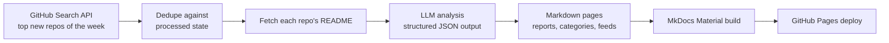

# 📡 Open Source Radar AI

**AI-curated radar of GitHub's hottest new repositories — analyzed, categorized, and published automatically every week.**

[](https://github.com/LokeshNanda/oss-radar-ai/actions/workflows/trending.yml)
[](LICENSE)
[](https://lokeshnanda.github.io/oss-radar-ai/)

👉 **Read this week's radar: [lokeshnanda.github.io/oss-radar-ai](https://lokeshnanda.github.io/oss-radar-ai/)**
📶 Subscribe: [RSS feed](https://lokeshnanda.github.io/oss-radar-ai/feed.xml) · Build on it: [JSON API](https://lokeshnanda.github.io/oss-radar-ai/api/latest.json)

Every Monday, this project finds the most-starred repositories created on GitHub in the last 7 days, generates an honest developer-focused breakdown of each one with an LLM (what it does, why it's interesting, how it works, how to try it, what to watch out for), and publishes everything as a static site — with zero manual steps.

---

## 📡 This week's radar

<!-- RADAR:START -->
_Week of 2026-10-26_

- [`pengchujin/aerial-tv`](https://github.com/pengchujin/aerial-tv) — 给国产电视的一块干净桌面：参照 tvOS 设计的开源 Android TV 桌面，没有广告，开机自动接管。A tvOS-style launcher for Xiaomi, TCL and other China-market TVs. ([analysis](https://lokeshnanda.github.io/oss-radar-ai/repos/pengchujin--aerial-tv/))
- [`simbasjungles/free-my-tv`](https://github.com/simbasjungles/free-my-tv) — A fast, ad-free home screen for Google TV, LG webOS and Samsung Tizen. One button to undo. ([analysis](https://lokeshnanda.github.io/oss-radar-ai/repos/simbasjungles--free-my-tv/))
- [`JustAResearcher/gpu-unlock-ada`](https://github.com/JustAResearcher/gpu-unlock-ada) — GPU tensor unlock source for RTX 4090 and experimental RTX 4070 Ti SUPER; firmware generated locally ([analysis](https://lokeshnanda.github.io/oss-radar-ai/repos/justaresearcher--gpu-unlock-ada/))
- [`JoasASantos/REA-Prompts`](https://github.com/JoasASantos/REA-Prompts) — REAP - Prompts for you to use REA (Reverse Engineer Anything), get the most out of it, and clone or break down any program ([analysis](https://lokeshnanda.github.io/oss-radar-ai/repos/joasasantos--rea-prompts/))
- [`EthanArbuckle/fairplay-decrypt`](https://github.com/EthanArbuckle/fairplay-decrypt) — Offline FairPlay App Store IPA decryption with independent key derivation ([analysis](https://lokeshnanda.github.io/oss-radar-ai/repos/ethanarbuckle--fairplay-decrypt/))
- [`wesbos/3d-model-anything`](https://github.com/wesbos/3d-model-anything) — Capture iPhone LiDAR and photos, reconstruct editable Three.js rooms, and explore them in a browser. ([analysis](https://lokeshnanda.github.io/oss-radar-ai/repos/wesbos--3d-model-anything/))
- [`xevrion/hatchzip`](https://github.com/xevrion/hatchzip) — HatchZip is a free, open-source archive extractor for Windows, macOS and Linux that extracts ZIP, 7z, RAR, tar and split archives in place, so it needs free space for the extracted files only. Desktop app and CLI. ([analysis](https://lokeshnanda.github.io/oss-radar-ai/repos/xevrion--hatchzip/))
- [`Jakeschincariol/day-trader-skill`](https://github.com/Jakeschincariol/day-trader-skill) — 11 Claude skills for day trading: scan thousands of charts, track breaking news, time every entry and exit, and replay every outcome before you risk a dollar. ([analysis](https://lokeshnanda.github.io/oss-radar-ai/repos/jakeschincariol--day-trader-skill/))
- [`ikow/php2shell-poc`](https://github.com/ikow/php2shell-poc) — CVE-2026-109618/109619 — 5 RCE chains + detection rules (Suricata, Sigma, ModSecurity). PHP session.upload_progress pre-auth exploit research. ([analysis](https://lokeshnanda.github.io/oss-radar-ai/repos/ikow--php2shell-poc/))
- [`oosexgang/hackios-xnu-kernel`](https://github.com/oosexgang/hackios-xnu-kernel) ([analysis](https://lokeshnanda.github.io/oss-radar-ai/repos/oosexgang--hackios-xnu-kernel/))
<!-- RADAR:END -->

---

## ⚙️ How it works



Everything runs in a single scheduled GitHub Actions workflow. Generated pages and state are committed back to the repo, so every run is reproducible and diffable.

## ✨ Features

- **Weekly radar reports** — the top 10 new repositories, ranked by stars
- **Developer-focused AI analysis** — grounded in each repo's README, honest about uncertainty, no hype
- **Deterministic & idempotent** — same inputs produce byte-identical output; repos are never analyzed twice
- **Fully automated** — fetch → analyze → publish with no human in the loop
- **Cheap to run** — roughly $0.05/week with `gpt-4o-mini`

## 🍴 Run your own radar

This project is designed to be forked. Point it at your favorite niche — a **Rust radar**, an **AI-agents radar**, a **security radar** — by changing a couple of environment variables, adding an API key, and enabling GitHub Pages. Follow the [10-minute setup guide](https://lokeshnanda.github.io/oss-radar-ai/run-your-own/).

## 🚀 Local development

```bash
python -m venv .venv
source .venv/bin/activate   # Windows: .venv\Scripts\activate
pip install -e ".[dev]"

# run the test suite
python -m pytest tests -q

# run the pipeline (needs OPENAI_API_KEY, optional GITHUB_TOKEN)
cp .env.example .env        # then fill in your keys
radar-run

# preview the site
mkdocs serve
```

### Configuration

| Variable                  | Default                  | Purpose                                                                   |
| ------------------------- | ------------------------ | ------------------------------------------------------------------------- |
| `OPENAI_API_KEY`          | —                        | Required. LLM API key                                                     |
| `OPENAI_MODEL`            | `gpt-4o-mini`            | Model used for analysis                                                   |
| `OPENAI_BASE_URL`         | `https://api.openai.com` | Any OpenAI-compatible endpoint                                            |
| `GITHUB_TOKEN`            | —                        | Optional. Raises GitHub API rate limits                                   |
| `GITHUB_PER_PAGE`         | `10`                     | Repos fetched per run                                                     |
| `GITHUB_DAYS_BACK`        | `7`                      | Lookback window in days                                                   |
| `RADAR_MAX_REPOS_PER_RUN` | `10`                     | Cap on repos analyzed per run                                             |
| `RADAR_BLOCKLIST_TERMS`   | —                        | Extra comma-separated terms added to the built-in cheat/malware blocklist |
| `RADAR_BLOCKED_REPOS`     | —                        | Comma-separated `owner/name` repos to never feature                       |

## 🗺 Roadmap

See [ROADMAP.md](ROADMAP.md) and the [design spec](specs/2026-07-24-popularity-roadmap-design.md).

## 📄 License

[MIT](LICENSE)
