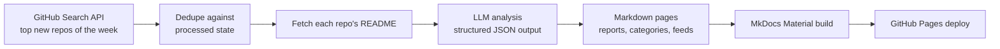

# 📡 Open Source Radar AI

**AI-curated radar of GitHub's hottest new repositories — analyzed, categorized, and published automatically every week.**

[](https://github.com/LokeshNanda/oss-radar-ai/actions/workflows/trending.yml)
[](LICENSE)
[](https://lokeshnanda.github.io/oss-radar-ai/)

👉 **Read this week's radar: [lokeshnanda.github.io/oss-radar-ai](https://lokeshnanda.github.io/oss-radar-ai/)**
📶 Subscribe: [RSS feed](https://lokeshnanda.github.io/oss-radar-ai/feed.xml) · Build on it: [JSON API](https://lokeshnanda.github.io/oss-radar-ai/api/latest.json)

Every Monday, this project finds the most-starred repositories created on GitHub in the last 7 days, generates an honest developer-focused breakdown of each one with an LLM (what it does, why it's interesting, how it works, how to try it, what to watch out for), and publishes everything as a static site — with zero manual steps.

---

## 📡 This week's radar

<!-- RADAR:START -->
_Week of 2026-09-28_

- [`jev-chat/jev-chat-jarvis`](https://github.com/jev-chat/jev-chat-jarvis) — 装在手机上的对话副驾：在 QQ / X / 飞书里读懂对方、给出候选回复、一键填入输入框，发不发由你。非侵入，只读屏幕，不 hook 不改包。 ([analysis](https://lokeshnanda.github.io/oss-radar-ai/repos/jev-chat--jev-chat-jarvis/))
- [`Contrastive-LM/CLM`](https://github.com/Contrastive-LM/CLM) ([analysis](https://lokeshnanda.github.io/oss-radar-ai/repos/contrastive-lm--clm/))
- [`unreallabsai/unreal-agent`](https://github.com/unreallabsai/unreal-agent) — Async-first agent harness ([analysis](https://lokeshnanda.github.io/oss-radar-ai/repos/unreallabsai--unreal-agent/))
- [`tobi/disktree`](https://github.com/tobi/disktree) — A treemap for finding and removing what fills your disk, for Omarchy. Rust + GPUI. ([analysis](https://lokeshnanda.github.io/oss-radar-ai/repos/tobi--disktree/))
- [`mexicat/pdoom-video`](https://github.com/mexicat/pdoom-video) — Code-rendered music video for "I'm Upping My P(doom)" ([analysis](https://lokeshnanda.github.io/oss-radar-ai/repos/mexicat--pdoom-video/))
- [`yetone/magpie`](https://github.com/yetone/magpie) — Every agent's model. One place. Codex on DeepSeek, Claude Code on Kimi, from the menu bar. ([analysis](https://lokeshnanda.github.io/oss-radar-ai/repos/yetone--magpie/))
- [`JohnHeibel/PDoomVideo`](https://github.com/JohnHeibel/PDoomVideo) — Source code for the Claude Opus 5.5 music video for I'm Upping My P(doom) ([analysis](https://lokeshnanda.github.io/oss-radar-ai/repos/johnheibel--pdoomvideo/))
- [`dzhng/jevgrep`](https://github.com/dzhng/jevgrep) — Find code by asking what it does. A CLI for coding agents that uses Jev to discover relevant files and source context. ([analysis](https://lokeshnanda.github.io/oss-radar-ai/repos/dzhng--jevgrep/))
- [`deepopen-com/deepopen`](https://github.com/deepopen-com/deepopen) — 非自回归System 1决策引擎，专为结构化类型决策场景设计  DeepOpen Multilingual, non-autoregressive System 1 decision engine. ([analysis](https://lokeshnanda.github.io/oss-radar-ai/repos/deepopen-com--deepopen/))
- [`mikehasa/golive-skill`](https://github.com/mikehasa/golive-skill) — Take your agent-built product live: hosting, database, domain, email, payments — on your own accounts. Open-source Agent Skill + zero-dependency Node CLI: detect → plan → approve → apply → verify. No GoLive account, backend or telemetry. ([analysis](https://lokeshnanda.github.io/oss-radar-ai/repos/mikehasa--golive-skill/))
<!-- RADAR:END -->

---

## ⚙️ How it works



Everything runs in a single scheduled GitHub Actions workflow. Generated pages and state are committed back to the repo, so every run is reproducible and diffable.

## ✨ Features

- **Weekly radar reports** — the top 10 new repositories, ranked by stars
- **Developer-focused AI analysis** — grounded in each repo's README, honest about uncertainty, no hype
- **Deterministic & idempotent** — same inputs produce byte-identical output; repos are never analyzed twice
- **Fully automated** — fetch → analyze → publish with no human in the loop
- **Cheap to run** — roughly $0.05/week with `gpt-4o-mini`

## 🍴 Run your own radar

This project is designed to be forked. Point it at your favorite niche — a **Rust radar**, an **AI-agents radar**, a **security radar** — by changing a couple of environment variables, adding an API key, and enabling GitHub Pages. Follow the [10-minute setup guide](https://lokeshnanda.github.io/oss-radar-ai/run-your-own/).

## 🚀 Local development

```bash
python -m venv .venv
source .venv/bin/activate   # Windows: .venv\Scripts\activate
pip install -e ".[dev]"

# run the test suite
python -m pytest tests -q

# run the pipeline (needs OPENAI_API_KEY, optional GITHUB_TOKEN)
cp .env.example .env        # then fill in your keys
radar-run

# preview the site
mkdocs serve
```

### Configuration

| Variable                  | Default                  | Purpose                                                                   |
| ------------------------- | ------------------------ | ------------------------------------------------------------------------- |
| `OPENAI_API_KEY`          | —                        | Required. LLM API key                                                     |
| `OPENAI_MODEL`            | `gpt-4o-mini`            | Model used for analysis                                                   |
| `OPENAI_BASE_URL`         | `https://api.openai.com` | Any OpenAI-compatible endpoint                                            |
| `GITHUB_TOKEN`            | —                        | Optional. Raises GitHub API rate limits                                   |
| `GITHUB_PER_PAGE`         | `10`                     | Repos fetched per run                                                     |
| `GITHUB_DAYS_BACK`        | `7`                      | Lookback window in days                                                   |
| `RADAR_MAX_REPOS_PER_RUN` | `10`                     | Cap on repos analyzed per run                                             |
| `RADAR_BLOCKLIST_TERMS`   | —                        | Extra comma-separated terms added to the built-in cheat/malware blocklist |
| `RADAR_BLOCKED_REPOS`     | —                        | Comma-separated `owner/name` repos to never feature                       |

## 🗺 Roadmap

See [ROADMAP.md](ROADMAP.md) and the [design spec](specs/2026-07-24-popularity-roadmap-design.md).

## 📄 License

[MIT](LICENSE)
