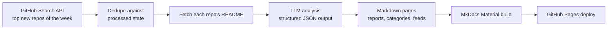

# 📡 Open Source Radar AI

**AI-curated radar of GitHub's hottest new repositories — analyzed, categorized, and published automatically every week.**

[](https://github.com/LokeshNanda/oss-radar-ai/actions/workflows/trending.yml)
[](LICENSE)
[](https://lokeshnanda.github.io/oss-radar-ai/)

👉 **Read this week's radar: [lokeshnanda.github.io/oss-radar-ai](https://lokeshnanda.github.io/oss-radar-ai/)**
📶 Subscribe: [RSS feed](https://lokeshnanda.github.io/oss-radar-ai/feed.xml) · Build on it: [JSON API](https://lokeshnanda.github.io/oss-radar-ai/api/latest.json)

Every Monday, this project finds the most-starred repositories created on GitHub in the last 7 days, generates an honest developer-focused breakdown of each one with an LLM (what it does, why it's interesting, how it works, how to try it, what to watch out for), and publishes everything as a static site — with zero manual steps.

---

## 📡 This week's radar

<!-- RADAR:START -->
_Week of 2026-11-16_

- [`huamidev/GestaltX`](https://github.com/huamidev/GestaltX) — An MobileGestalt editor for iOS 27.x, featuring region-code tweaks, device presets, backups. ([analysis](https://lokeshnanda.github.io/oss-radar-ai/repos/huamidev--gestaltx/))
- [`deepseek-ai/chat-demo`](https://github.com/deepseek-ai/chat-demo) — Chat Demo ([analysis](https://lokeshnanda.github.io/oss-radar-ai/repos/deepseek-ai--chat-demo/))
- [`apex-compute/ANR`](https://github.com/apex-compute/ANR) — Apex Neural Rendering (ANR) by Apex Compute ([analysis](https://lokeshnanda.github.io/oss-radar-ai/repos/apex-compute--anr/))
- [`Kianuni/Erosion-CN`](https://github.com/Kianuni/Erosion-CN) — iOS / iPadOS 系统配置与 MobileGestalt 研究工具箱（中英双语 · 防白苹果安全加固版） | Bootloop-safe iOS / iPadOS System Configuration & MobileGestalt Toolbox (Bilingual EN/ZH) ([analysis](https://lokeshnanda.github.io/oss-radar-ai/repos/kianuni--erosion-cn/))
- [`hitkeeen/blender-ai-mcp-addon`](https://github.com/hitkeeen/blender-ai-mcp-addon) — AI assistant and MCP server for Blender: visual chat, scene tools, multi-agent workflows. Works with ChatGPT/GPT, Claude, Gemini, Ollama, OpenCode. Blender AI addon, copilot for 3D, bpy Python scripting, MCP integration. ([analysis](https://lokeshnanda.github.io/oss-radar-ai/repos/hitkeeen--blender-ai-mcp-addon/))
- [`FrigadeHQ/yogurt`](https://github.com/FrigadeHQ/yogurt) — Private AI meeting notes that stay on your computer. A free, open-source alternative to Granola for Mac, Windows and Linux. ([analysis](https://lokeshnanda.github.io/oss-radar-ai/repos/frigadehq--yogurt/))
- [`HybridRobotics/supermimic`](https://github.com/HybridRobotics/supermimic) — Humanoid whole-body motion tracking with one differentiable world model. ([analysis](https://lokeshnanda.github.io/oss-radar-ai/repos/hybridrobotics--supermimic/))
- [`agentes-chat/agentes-chat`](https://github.com/agentes-chat/agentes-chat) — Open-source, self-hosted Slack alternative where your team and AI agents work together in channels and DMs. Agents run on Claude, ChatGPT/Codex, Gemini or Grok, with MCP tools, their own computer and browser, routines, memory and approvals. Web, desktop and phone apps. Docker Compose + Postgres. AGPL-3.0. ([analysis](https://lokeshnanda.github.io/oss-radar-ai/repos/agentes-chat--agentes-chat/))
- [`Noniv/abyssal-garden`](https://github.com/Noniv/abyssal-garden) — A dreamy underwater world you can swim through in your browser: swaying kelp forests, sunbeams, a sunken ship and manta rays. Everything is generated by code with WebGPU (no images, models or sound files), all in a single 97 KB HTML file. ([analysis](https://lokeshnanda.github.io/oss-radar-ai/repos/noniv--abyssal-garden/))
- [`duwqijlk/muse-protocol`](https://github.com/duwqijlk/muse-protocol) — muse.ai 注册与邀请码兑换协议研究（纯 HTTP Python 实现） ([analysis](https://lokeshnanda.github.io/oss-radar-ai/repos/duwqijlk--muse-protocol/))
<!-- RADAR:END -->

---

## ⚙️ How it works



Everything runs in a single scheduled GitHub Actions workflow. Generated pages and state are committed back to the repo, so every run is reproducible and diffable.

## ✨ Features

- **Weekly radar reports** — the top 10 new repositories, ranked by stars
- **Developer-focused AI analysis** — grounded in each repo's README, honest about uncertainty, no hype
- **Deterministic & idempotent** — same inputs produce byte-identical output; repos are never analyzed twice
- **Fully automated** — fetch → analyze → publish with no human in the loop
- **Cheap to run** — roughly $0.05/week with `gpt-4o-mini`

## 🍴 Run your own radar

This project is designed to be forked. Point it at your favorite niche — a **Rust radar**, an **AI-agents radar**, a **security radar** — by changing a couple of environment variables, adding an API key, and enabling GitHub Pages. Follow the [10-minute setup guide](https://lokeshnanda.github.io/oss-radar-ai/run-your-own/).

## 🚀 Local development

```bash
python -m venv .venv
source .venv/bin/activate   # Windows: .venv\Scripts\activate
pip install -e ".[dev]"

# run the test suite
python -m pytest tests -q

# run the pipeline (needs OPENAI_API_KEY, optional GITHUB_TOKEN)
cp .env.example .env        # then fill in your keys
radar-run

# preview the site
mkdocs serve
```

### Configuration

| Variable                  | Default                  | Purpose                                                                   |
| ------------------------- | ------------------------ | ------------------------------------------------------------------------- |
| `OPENAI_API_KEY`          | —                        | Required. LLM API key                                                     |
| `OPENAI_MODEL`            | `gpt-4o-mini`            | Model used for analysis                                                   |
| `OPENAI_BASE_URL`         | `https://api.openai.com` | Any OpenAI-compatible endpoint                                            |
| `GITHUB_TOKEN`            | —                        | Optional. Raises GitHub API rate limits                                   |
| `GITHUB_PER_PAGE`         | `10`                     | Repos fetched per run                                                     |
| `GITHUB_DAYS_BACK`        | `7`                      | Lookback window in days                                                   |
| `RADAR_MAX_REPOS_PER_RUN` | `10`                     | Cap on repos analyzed per run                                             |
| `RADAR_BLOCKLIST_TERMS`   | —                        | Extra comma-separated terms added to the built-in cheat/malware blocklist |
| `RADAR_BLOCKED_REPOS`     | —                        | Comma-separated `owner/name` repos to never feature                       |

## 🗺 Roadmap

See [ROADMAP.md](ROADMAP.md) and the [design spec](specs/2026-07-24-popularity-roadmap-design.md).

## 📄 License

[MIT](LICENSE)
